<div align="center">


### Quando acontece um desastre, saber onde procurar já é metade da resposta.

Portal educativo e bilíngue que leva você, em poucos toques, à orientação **oficial** da Defesa Civil para cada tipo de desastre.

**[reajaa.vercel.app](https://reajaa.vercel.app/)** &nbsp;·&nbsp; Português &nbsp;·&nbsp; English

<br>

</div>

---

## Por que o Reaja existe

Em uma emergência, a pessoa não tem tempo nem calma para procurar em sites de governo, abrir PDFs soltos e adivinhar qual deles serve para a situação em que está. As orientações oficiais de autoproteção **existem**, são feitas por quem entende do assunto e estão publicadas pela Secretaria Nacional de Proteção e Defesa Civil (Sedec/MIDR), mas ficam espalhadas em vários arquivos, difíceis de achar no celular na hora do susto.

O Reaja nasceu para **encurtar esse caminho**:

> **identificar o que está acontecendo → abrir a orientação oficial correta**, sem rodeios.

Ele não tenta substituir a Defesa Civil nem reescrever as recomendações. Ele é uma **porta de entrada**: organiza os 13 temas, explica de forma visual do que cada um se trata e leva direto para a fonte oficial.

## O que o site oferece

| | |
|---|---|
| **Busca e filtros** | Encontre o desastre pelo nome ou filtre por categoria: hídricos, geológicos, meteorológicos, climáticos e saúde, tecnológicos. |
| **Ilustrações próprias** | Cada tema tem uma ilustração em SVG, nítida em qualquer tela, para reconhecer a situação num relance. |
| **Contatos sempre à vista** | Barra fixa com Defesa Civil **199**, Bombeiros **193**, SAMU **192**, Polícia Militar **190** e o **SMS 40199** para alertas, tudo com toque para ligar. |
| **Link direto ao PDF oficial** | Cada página aponta para o material da Sedec/MIDR no gov.br. |
| **Funciona offline** | Depois da primeira visita, as páginas e as ilustrações ficam guardadas para consulta sem internet (os PDFs do gov.br continuam exigindo conexão). |
| **Tema claro e escuro** | Respeita a preferência do aparelho e pode ser trocado no cabeçalho. |
| **Português e inglês** | Interface completa nos dois idiomas. |
| **Imprimir e compartilhar** | Salve a página em PDF, imprima ou envie o link por WhatsApp e pelo compartilhamento do celular. |
| **Sem rastreamento** | Sem cookies de rastreamento e sem analytics. |


## Os 13 temas

<table>
<tr>
<td align="center">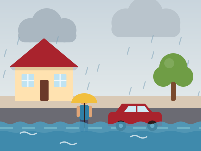<br><sub><b>Alagamentos</b></sub></td>
<td align="center">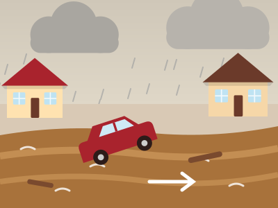<br><sub><b>Enxurradas</b></sub></td>
<td align="center">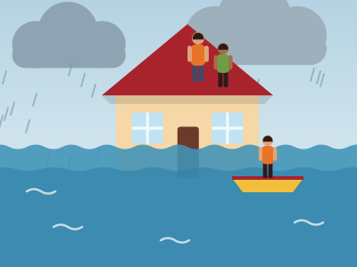<br><sub><b>Inundações</b></sub></td>
<td align="center">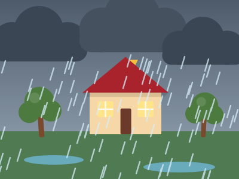<br><sub><b>Chuvas intensas</b></sub></td>
</tr>
<tr>
<td align="center"><br><sub><b>Deslizamentos</b></sub></td>
<td align="center">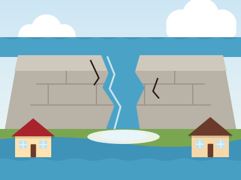<br><sub><b>Rompimento de barragens</b></sub></td>
<td align="center">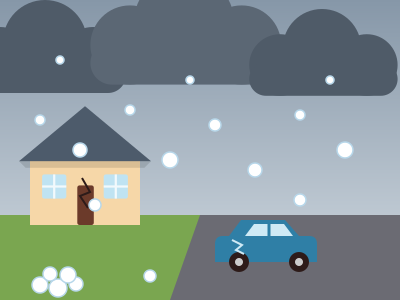<br><sub><b>Granizo</b></sub></td>
<td align="center">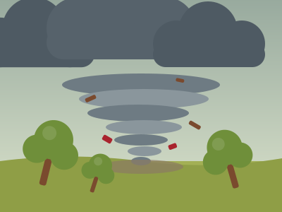<br><sub><b>Tornados</b></sub></td>
</tr>
<tr>
<td align="center">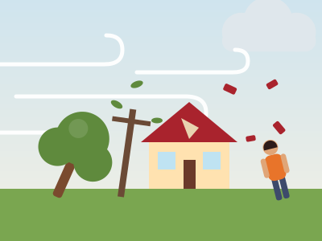<br><sub><b>Vendavais</b></sub></td>
<td align="center">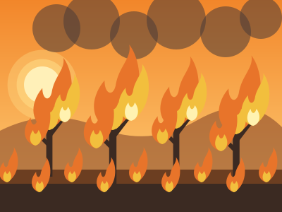<br><sub><b>Incêndios florestais</b></sub></td>
<td align="center">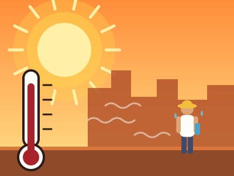<br><sub><b>Ondas de calor</b></sub></td>
<td align="center">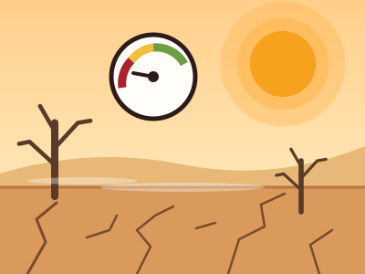<br><sub><b>Baixa umidade do ar</b></sub></td>
</tr>
<tr>
<td align="center">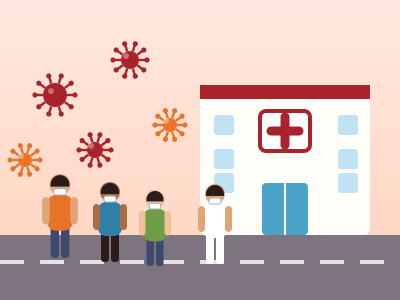<br><sub><b>Doenças infecciosas virais</b></sub></td>
<td></td><td></td><td></td>
</tr>
</table>

## Princípios do projeto

- **Fonte oficial em primeiro lugar.** O site identifica a fonte e leva ao material da Sedec/MIDR; não reproduz nem resume as recomendações.
- **Leitura rápida, mesmo sob estresse.** Poucos elementos, texto grande, contraste forte e contatos de emergência sempre visíveis.
- **Pensado para o celular.** É nele que a maioria das pessoas vai consultar na hora do aperto.
- **Leve e acessível.** HTML, CSS e JavaScript nativos, sem bibliotecas de interface; link para pular ao conteúdo, rótulos para leitores de tela e respeito a `prefers-reduced-motion`.
- **Privacidade.** Nada de rastreadores.

> **Aviso importante:** o Reaja é um portal educativo e **não substitui** alertas, instruções ou atendimento da Defesa Civil local. Em emergência, ligue **199** (Defesa Civil), **193** (Bombeiros), **192** (SAMU) ou **190** (Polícia Militar) e siga as orientações das autoridades da sua região.

## Tecnologia e design

Site estático, sem etapa de build: HTML, CSS e JavaScript nativos, com PWA (manifest + service worker).

- **Tipografia:** Archivo Black nos títulos principais, Clash Grotesk em títulos menores e controles, Chillax no texto corrido e Tanker em marcas e rótulos. Carregadas do Google Fonts e do Fontshare; sem rede, o navegador usa fontes do sistema.
- **Paleta:** vermelho, laranja e amarelo com neutros quentes, ajustada para os temas claro e escuro.
- **Ilustrações:** SVGs em estilo plano, todas em proporção 4:3 e com a mesma paleta (`assets/illustrations/`).
- **Cache offline:** o service worker busca primeiro na rede e usa o cache só quando não há conexão, para o site não ficar preso em versões antigas.

### Estrutura

```
Reaja/
├── pt/ · en/                rotas de cada idioma (uma página por tema)
├── data/
│   ├── disasters.js         catálogo dos 13 temas
│   └── i18n.js              textos da interface
├── assets/
│   ├── app.js · site.css    comportamento e estilos
│   ├── illustrations/       ilustrações SVG dos 13 temas
│   └── icons, logo, PWA     ícones, lettering e símbolo
├── docs/                    imagens usadas neste README
├── sw.js · manifest.webmanifest
└── sitemap.xml · robots.txt
```

## Executar localmente

O service worker não funciona em `file://`, então sirva a pasta por HTTP. Com Python instalado, dentro da pasta do projeto:

```bash
python -m http.server 8000
```

Abra `http://localhost:8000/pt/`.

## Publicar

Publique a pasta como site estático em Vercel, Netlify ou Cloudflare Pages, com `/pt` como entrada padrão se a plataforma exigir. Antes de publicar, troque `https://reaja.example` pelo domínio real em `robots.txt` e `sitemap.xml`. É necessário HTTPS para o service worker em produção.

## Contribuir com um novo tema ou idioma

- **Novo desastre:** acrescente os campos PT/EN em `data/disasters.js`, atribua um slug e o link do PDF oficial, mantenha o ícone no grid 24×24 com traço de 1.8 e adicione `assets/illustrations/<slug>.svg` (viewBox `0 0 400 300`). Inclua também o slug em `sw.js` e crie as páginas em `pt/<slug>/` e `en/<slug>/`.
- **Novo idioma:** crie o diretório da rota e as traduções da interface em `data/i18n.js`. **Não traduza o conteúdo da Sedec sem autorização.**

## Conteúdo e licença

As páginas identificam a fonte e levam aos PDFs oficiais da Secretaria Nacional de Proteção e Defesa Civil (Sedec/MIDR). Esses PDFs são licenciados sob **CC BY-ND 3.0**: permitem compartilhamento com atribuição, mas **não derivações**.

**Solicite autorização formal ao MIDR antes de adaptar, resumir, reformatar editorialmente ou traduzir as recomendações oficiais.** Por isso, a interface em inglês exibe marcadores `[VERIFY]` e direciona ao material original, sem publicar tradução de instruções de segurança.

---

<div align="center">
<sub>Feito com cuidado, para que ninguém precise procurar quando mais precisa saber.</sub>
</div>
